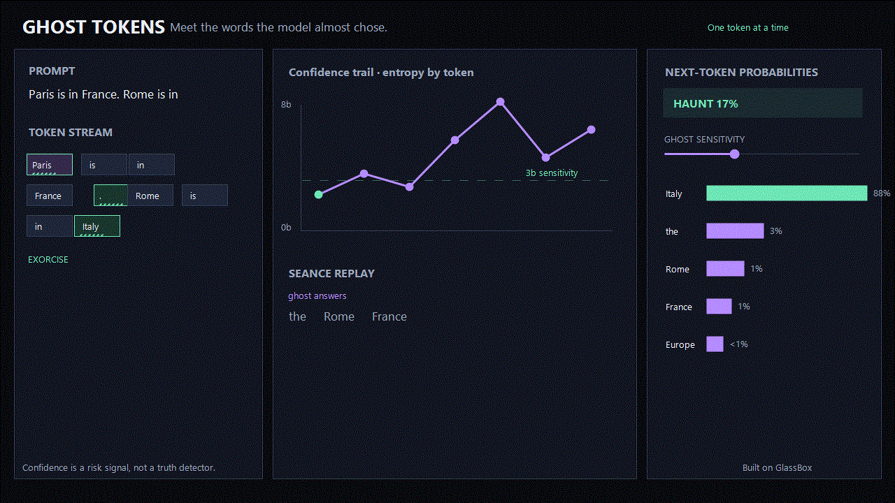

# 👻 Ghost Tokens: Meet the words the model almost chose

Watch uncertainty appear token by token. **Ghost Tokens** marks low-solidity choices, plots the confidence trail, and lets you replay or branch an answer to see what else the model might have said.



**Built on GlassBox** — an inspectable, from-scratch NumPy inference engine.

## What you can do

- **Spot ghosts:** content tokens are ghosts only when both full-vocabulary entropy is high (4.5 bits at the default setting) and raw chosen-token confidence is low (below 15%). Whitespace- and punctuation-only tokens are excluded.
- **Tune sensitivity live:** one slider adjusts both thresholds and re-flags the existing answer immediately. Haunt level is the percentage of countable answer tokens flagged.
- **Inspect confidence:** select a token to see its full-vocabulary chosen probability, entropy, top-1/top-2 probability margin, and the leading alternatives from the top-200 logits.
- **Follow the confidence trail:** the chart plots entropy in bits by token position. The dashed line follows the current entropy threshold; click any point to inspect that token.
- **Replay a séance:** play or step through the answer and see the other leading candidates as faded ghost answers.
- **Exorcise a ghost:** force its best other top-200 candidate and generate a continuation. The interface compares the original haunt level with the new branch suffix.
- **Explore the model:** inspect attention, top-token probabilities, and the logit lens under the collapsed “Under the hood” section; click a probability bar to branch with any visible candidate.
- **Choose the atmosphere:** spooky mode adds a restrained fog treatment and heading font; switch it off for a clean, plain interface.

## Quick start

Requires Python 3.11 or later. SmolLM2-135M weights download separately and use about 270 MB of disk space.

```powershell
git clone https://github.com/bistighosh16/glassbox.git
cd glassbox
python -m venv venv
.\venv\Scripts\Activate.ps1
pip install -e .
python download_model.py
ghost-tokens serve
```

Open [http://localhost:8000](http://localhost:8000). A saved trace loads immediately so you can explore an answer before the model runs. Choose the easy or obscure prompt (or enter your own) and press **generate** to run a live answer; live generation defaults to eight tokens. On macOS or Linux, activate the environment with `source venv/bin/activate`.

The saved-trace-only page in [`glassbox/web/demo.html`](glassbox/web/demo.html) can be hosted on GitHub Pages or any static host. It uses the same trace data and ghost rule as the app and does not need the model server.

The model is [SmolLM2-135M](https://huggingface.co/HuggingFaceTB/SmolLM2-135M) by Hugging Face; see its model card for licensing. The weights are not included in this repository.

## Important limitations

- **Confidence is a risk signal, not a truth detector.** A ghost flag means the model's distribution looks uncertain under the selected thresholds; it does not mean the generated claim is false. A confident token can still be wrong.
- **Synonym caveat:** token-level alternatives are not semantic alternatives. A different token may be a synonym, a different spelling, or a token that only makes sense in a different continuation. The top-200 alternatives are local candidates, not a complete list of possible answers.
- Raw confidence for the chosen token is computed over the full vocabulary. Probability bars are a temperature-scaled preview over the top 200 candidates; alternative percentages are normalized within that shortlist, not over the full vocabulary.
- Attention visualizes weight allocation; it does not prove why the model produced an answer.
- SmolLM2-135M is a small base model and can drift or repeat. Inference is CPU NumPy; GPU execution, batching, and quantization are not implemented.

## Architecture and checks

Ghost Tokens streams generation and trace data from a local FastAPI server to a plain HTML/CSS/JavaScript client. The UI has no frontend build step. The model's forward pass, KV cache, attention, and logit-lens traces are provided by the GlassBox engine.

```powershell
pip install -r requirements-dev.txt
python -m pytest -q
```

The test suite checks numerical behavior and selected reference cases; those checks are not a broad benchmark.

## Credits and license

**Built on GlassBox** by Vivi, an open-source NumPy transformer inference and interpretability project. Ghost Tokens keeps the `glassbox` Python package as its engine. The code is available under the [MIT License](LICENSE); the model has its own license terms.
